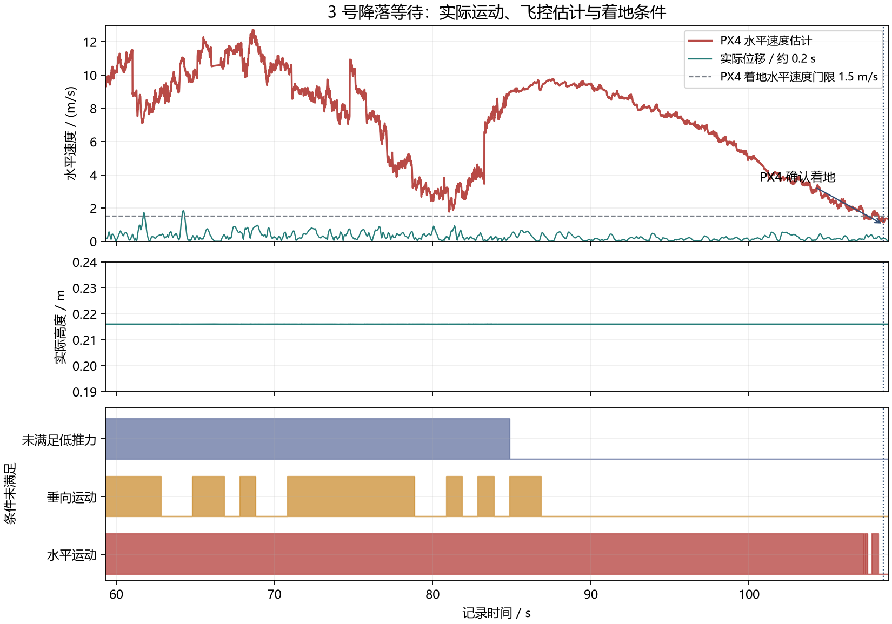

# 飞控反馈有效期与降落等待

日期：2026-10-15。平台：Gazebo/PX4 四机仿真、LicheeRV Nano riscv64。

## 飞控反馈

伴随程序以本机单调时钟检查原生 MAVLink 消息：心跳有效期为 3 秒，`EXTENDED_SYS_STATE` 着地反馈有效期为 0.5 秒。着地消息请求频率为 10 Hz。重新连接或解锁状态变化后，必须重新收到着地消息。

心跳过期时，状态输出为 `heartbeat_fresh=false`、`armed=true`、`landed=false`，表示尚不能确认停机；OFFBOARD 和 AUTO/LAND 状态同时失效。只有新鲜的原生着地反馈才能输出 `landed=true`。控制日志和队伍状态包均保存 `heartbeat_fresh`、`landed_fresh`。

接收端绑定首个有效 PX4 自动驾驶组件的 system ID 和 component ID，其他设备或组件的消息不能覆盖状态。解锁请求需要当前的未解锁、已着地反馈；解除武装需要当前的已解锁、已着地反馈。IMU 或外部观测中断不阻止原生反馈有效时的解除武装。

已解锁时收到 `MAV_STATE_CRITICAL`、`MAV_STATE_EMERGENCY` 或 `MAV_STATE_FLIGHT_TERMINATION` 会锁存任务失败，停止发送任务参考和 ARM/OFFBOARD 请求；后续健康心跳不恢复原任务。飞控尚未进入 AUTO/LAND 时仍可发送普通 LAND 请求，由飞控判断是否接受。`ABORT_RETURN` 与正常返航一样检查持续贴地和卡住状态。

已解锁期间心跳处理间隔达到 3 秒时，`heartbeat_gap_latched=true` 会终止原任务。新心跳更新接收时间之前先检查间隔，避免进程恢复后，排队的健康心跳覆盖中断事实。未解锁状态下的连接间隔不锁存任务失败。

## 49 秒等待的条件

历史运行 `run_20261015_074946` 的 3 号于 59.321 s 被判为无法继续任务，PX4 于 108.504 s 确认着地，间隔 49.183 s。

独立物理轨迹显示机体在约 0.216 m 高度持续接触地形，同时仍有水平滑动。60 s 附近，约 0.196 s 位移窗口得到的实际水平速度为 0.033 m/s；PX4 水平速度估计为 10.165 m/s。

| 未满足的条件 | 日志累计时间 / s |
|---|---:|
| 水平运动 | 48.390 |
| 低推力 | 25.559 |
| 垂向运动 | 18.551 |
| 下降请求 | 3.511 |
| 旋转运动 | 1.503 |
| 接近地面 | 0.000 |

各条件可同时阻塞，时间不能相加。累计值按原生日志时间保持前一条状态计算，最大采样间隔为 1.008 s。实际位移与原生速度分开计算，物理轨迹未输入控制器。



15 组位置一致的外部里程计发送/接收记录给出 -1–8 ms 的记录时间差，中位数为 5 ms，其中包含链路延迟。分析保留两份日志的原时间轴，没有将接收延迟当成固定时钟偏移。恢复窗口内，1639 条外部里程计记录中有 1636 条未提供速度。

当前 PX4 源码版本为 `99c40407ffd7ac184e2d7b4b293f36f10fe561ef`。其 `_get_ground_contact_state()` 同时检查水平运动、垂向运动、推力及下降条件。消息有效期检查防止使用过期反馈；49 秒等待的估计漂移仍需可靠的运动反馈解决。

分析程序为 `scripts/summarize_landing_delay.py`。缺少失效事件、原生着地确认、物理轨迹覆盖或至少三组里程计位置匹配时，程序报错。

```powershell
$ErrorActionPreference = 'Stop'
& ./.venv/Scripts/python.exe -X utf8 scripts/summarize_landing_delay.py simulation/runtime/run_20261015_074946 --vehicle 3 --ulog build/nano-landing-delay/23_49_53.ulg --output build/nano-landing-delay/diagnostic.json
if ($LASTEXITCODE -ne 0) { throw 'Landing delay analysis failed' }
```

## 回归与闭环验证

| 检查 | 结果 |
|---|---|
| 完整 CTest | 16/16 通过 |
| 无 OpenCV CTest | 15/15 通过 |
| UDP/MAVLink 收包回归 | 9 项通过，覆盖消息断流、重新解锁、设备干扰、IMU 缺失时解除武装、原生失效保护锁存、未解锁预检告警、中止返航贴地恢复、暂停后排队的健康心跳 |
| 降落条件统计测试 | 3 项通过，检查不规则采样积分、禁止采用未来样本、缺失覆盖和无效窗口 |
| Nano 静态测试 | 返回 0 |

旧程序在停止发送着地消息后持续上报 `landed=true`，同一收包回归在修复后通过。原生失效保护、中止返航贴地和暂停恢复回归也分别先复现缺失行为，再通过修复后的程序。Nano 启动 ID 为 `0bbba2cb-823b-4477-86c2-3bf1f140a056`；包含失效保护和连接中断锁存的静态测试二进制 SHA256 为 `c582a205ee633d521173dac06575fe3bd32308e4830f9f93e99f0684f44e5bc1`。

| 场景 | 运行目录 | 结果 |
|---|---|---|
| 默认地图完整任务 | `run_20261015_081355` | 1、2、3 号返航并原生确认着地停机；0 号出界后持续下降，180 s 上限处仍处于 LAND_ALL，全队恢复未通过 |
| 起飞阶段超时后返航降落 | `run_20261015_081908` | 四机原生确认着地停机，18.961 s 进入 ABORTED，最终距起飞点水平误差为 0.0069–0.0650 m |
| 心跳间隔锁存后的默认地图 | `run_20261015_084412` | 2 号未实际离地，47.981 s 起飞超时中止；48.981 s 中止返航贴地恢复生效，56.321 s 四机着地停机并进入 ABORTED |

起降验证地图将 `stage_timeout_s` 设为 3，并清空 `transit_waypoints`，在起飞阶段触发中止。两组均未出现降落后的 ARM/OFFBOARD 请求；解除武装请求均对应同一控制周期内有效的原生着地反馈。默认地图三次返航航点切换满足收敛条件。

默认地图的 0 号于 24.781 s 进入失效恢复，终止前物理位置为约 `(131.576, 48.274, -104.847) m`，飞控仍报告未着地、已解锁。该运行没有取得全队停机确认。出界后的物理承接面、定位有效性和失控检测需要继续核验。

该机于 19.833 s 接触装甲滑台外壳，PX4 于 22.068 s 进入原生失效保护；随后伴随程序曾请求 OFFBOARD。失效保护锁存修复针对这类任务接管行为，尚无完整接触任务通过的结论。

## 进程暂停注入

两次注入均在起飞过程中暂停 0 号伴随程序，再恢复进程。原生 ULog 确认触发失效保护；伴随日志没有记录 `native_failsafe_latched=true`，因此不能据此确认锁存分支在暂停恢复时生效。

| 暂停时长 | 运行目录 | 原生失效保护区间 | 停止时状态 |
|---|---|---|---|
| 1.8 s | `run_20261015_083056` | 11.235–12.445 s | ABORT_RETURN；四机均未取得原生停机确认 |
| 5.0 s | `run_20261015_083743` | 11.190–15.460 s | LAND_ALL；1、2、3 号着地停机，0 号未着地、已解锁 |

5 秒注入后，0 号水平定位失效，外部速度停止融合，仍有高度输入。它在约 0.566 m 高度停留，任务没有取得全队终态。两次注入均由测试工具终止并确认全部仿真进程退出。

加入心跳间隔锁存后的 5 秒复测为 `run_20261015_084313`：0 号于 15.321 s 记录 `HEARTBEAT_GAP` 并请求 LAND，16.168 s 取得原生着地确认，16.270 s 解除武装；全队于 22.981 s 进入 ABORTED，四机着地停机校验通过。0 号最终距起飞点水平误差为 0.1460 m，其余三机为 0.0076–0.0370 m。失效后无 ARM/OFFBOARD 请求，解除武装均有当前着地反馈。

这组结果验证达到 3 秒的中断。较短暂停可能错过 CRITICAL 消息，仍需核验原生模式退出和任务恢复之间的关系；定位失效时的 LAND_ALL 退化控制也需继续验证。

配置、源码快照、二进制哈希、原生 ULog、恢复汇总和反馈审计位于 `build/nano-flight-feedback/{closed-loop,abort-landing}/`。Nano 记录位于 `build/nano-flight-feedback/board-tests/result.json`；历史降落分析位于 `build/nano-landing-delay/diagnostic.json`。

暂停注入记录位于 `build/nano-flight-feedback/{failsafe-landing,failsafe-landing-5s}/`；Nano 失效保护测试记录位于 `failsafe-board-tests/result.json`。

心跳间隔锁存复测的源码快照、原生模式变化、反馈审计和着地停机校验位于 `build/nano-flight-feedback/gap-recovery-5s/`，Nano 记录位于 `gap-board-tests/result.json`。

默认地图复测位于 `build/nano-flight-feedback/gap-default/`。原生日志记录了 2 号反复出现传感器 STALE；尚未确定未离地原因。这组通过全队停机校验，没有进入接触阶段。
