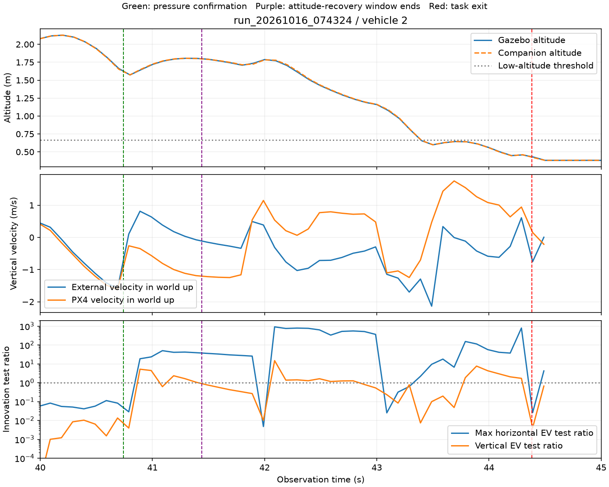

# 接触后垂向速度与低高度退出

日期：2026-10-16。报告实现：`4a4f952`、`3485fbd`。分析对象：`run_20261016_074324/2`。

## 轨迹与退出

2 号在 40.741 s 取得合格压力确认，随后进入 RETREAT。44.381 s 的估计高度为 0.4189 m，实际轨迹也已降至约 0.42 m。持续低于 0.666 m 的条件达到 1 s 后，runner 退出任务并请求原生 LAND；最终确认原生着地、普通 DISARM，距起点 13.5412 m。

该次退出具有真实低高度依据，不能通过延长或取消贴地保护修复。原生着地标志在首次低高度退出前仍为 false；保护由估计高度补充触发。

图中绿色线为压力确认，紫色线为 0.7 s 姿态恢复窗口结束，红色线为任务退出。图内轨迹以 100 ms 步长取前一条记录用于观察；正式速度统计使用全部可匹配的外部里程计记录。

## 已核对的输入

外部速度在机体 FRD 系发送。按同条里程计四元数转回世界系向上分量，与伴随日志的世界垂向速度相符。使用相近时刻的原生姿态重复投影，接触后的部分样本仍保持相同方向。因此，现有记录不支持垂向符号颠倒这一解释。

接触后的代表性观测：

| 观测时间 / s | 实际高度 / m | 伴随估计 vz（向上）/ m/s | PX4 vz（向上）/ m/s | 状态 |
|---|---:|---:|---:|---|
| 40.8 | 1.573 | +0.105 | −0.212 | RETREAT，压力确认后 |
| 41.0 | 1.719 | +0.639 | −0.584 | 姿态恢复窗口内 |
| 41.4 | 1.803 | −0.075 | −1.192 | 姿态恢复窗口内 |
| 42.6 | 1.354 | −0.711 | +0.794 | RETREAT，速度控制 |
| 43.4 | 0.656 | −1.294 | −0.617 | 已低于高度门限 |
| 44.4 | 0.427 | −0.752 | +0.073 | 已进入 RECOVER_LAND |

姿态恢复期间的外部速度新息在接触后超限，部分时间横向检验比达到数十乃至数百。其后出现明显姿态变化和推力变化，伴随高度仍紧跟实际高度。日志中的 `cs_ev_vel`、`cs_ev_hgt` 为 true，不代表该时刻所有外部测量均通过新息检查。

检查原生 IMU 时，在 40.796–40.800 s 的原生时钟记录中找到约 282.7 m/s² 的比力峰值，`accelerometer_clipping=0`。250 Hz 原生记录包含冲击峰值，现有证据不能断言冲击被 IMU 完全漏采；其积分、时间关系与状态修正仍需进一步验证。

## 可重复的速度一致性报告

[summarize_recovery_ulog.py](../scripts/summarize_recovery_ulog.py)增加 `post_contact_velocity`，对每次压力确认之后四秒进行检查：

- 局部 NED/FRD 速度以负 Z 为向上；机体 FRD 速度用同条里程计四元数投影到世界向上方向。
- 使用外部输入的 `timestamp_sample`，匹配不晚于它的最新原生垂向速度，最大年龄为 50 ms。
- 非有限输入、不支持的坐标帧、无效四元数及原生 `v_z_valid=false` 不参与统计；缺失与无效数量分别报告。
- 输出配对数量、绝对差中位数、P95、最大值及差值超过 1 m/s 的样本数量。

接触事件窗口使用已有 `imu_clock_alignment` 将观测时间映射到原生时间；这是当前 runner 的首包时间映射，不构成独立硬件时钟同步证据。速度配对本身在原生日志的采样时间域完成。

9 项回归覆盖垂向符号、滚转/俯仰投影、四元数尺度、非法输入、原生有效标志、采样时刻与发布时间的区别、禁止使用未来原生样本，以及 50 ms 年龄边界。

五组历史运行共 16 次压力确认、3,507 个有效配对。新增字段之外，原恢复报告逐项保持一致，原生着地停机及 ARM/OFFBOARD 重试验收没有改变。

| 样本 | 配对数 | 绝对差中位数 / m/s | 绝对差 P95 / m/s | 超过 1 m/s 的样本数 |
|---|---:|---:|---:|---:|
| 失败重复组 2 号 | 219 | 1.077 | 1.741 | 127 |
| 完整成功组 0 号 | 219 | 0.261 | 1.776 | 61 |
| 完整成功组 1 号 | 249 | 0.236 | 1.498 | 63 |
| 完整成功组 2 号 | 223 | 0.215 | 1.308 | 57 |
| 完整成功组 3 号 | 216 | 0.211 | 2.490 | 59 |

成功返航也存在短时较大差值，五组所有事件的最大差值范围为 0.804–6.569 m/s。这些差值用于定位输入和融合问题，尚不能直接作为任务退出或接触恢复完成门限。

## 下一项验证

先对照原生 IMU 积分、外部速度新息拒绝与原生速度修正的时间关系，确认接触后的状态偏差来源；再验证恢复阶段的控制与观测策略。保持压力评分、1 s 低高度保护、500 ms 控制流保护和原生着地停机确认。

## 证据

- `build/nano-postcontact-height/repeat-2-timeline.json`：实际高度、估计高度、姿态、参考与推力时间线。
- `build/nano-postcontact-height/native-velocity-evidence.json`：机体系速度投影、原生速度、新息和融合状态。
- `build/nano-postcontact-height/velocity-comparison.json`：五组 16 次事件的全样本统计。
- `build/nano-postcontact-height/*-recovery.json`：新增诊断字段后的恢复报告。
- `build/nano-postcontact-height/final-tests.log`：9 项回归。
