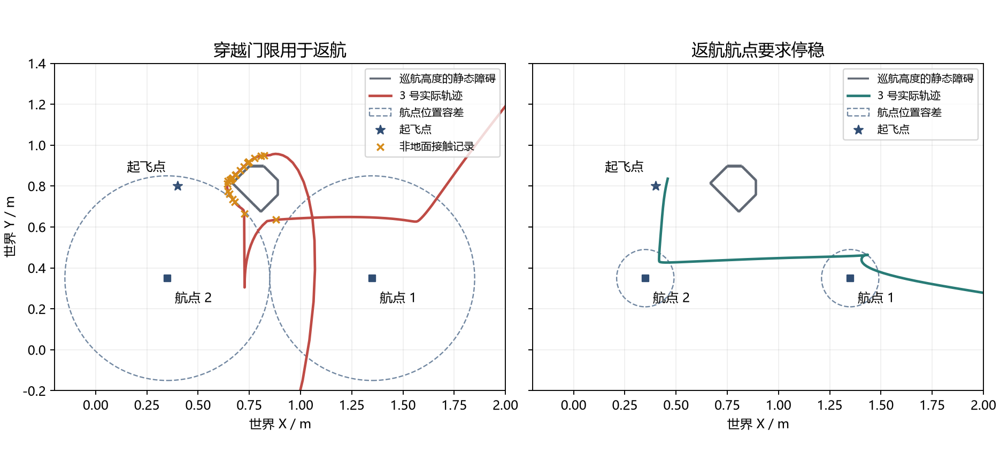

# 返航航点收敛与地形接触

日期：2026-10-15。场景：Gazebo/PX4，`rmuc_2026_sentry26`，四机 `team_contact`。

## 返航条件

RETURN_ALL 和 ABORT_RETURN 的每个航路点使用 `return_tolerance_m` 检查水平位置，垂向容差为 0.08 m，三维估计速度不超过 0.30 m/s，连续满足 `stable_s` 后切换下一段。去程 TRANSIT 的穿越模式仍使用路线位置和速度容差。

当前地图的返航水平容差为 0.14 m。此前返航沿用了去程的 0.5 m、5.5 m/s 穿越门限，允许尚未收敛的成员提前转向。

## 接触与轨迹

`run_20261015_071455` 的 3 号于 67.813 s 在约 1.56 m 高度记录到非地面接触，之后发生明显姿态翻转，再于 71.261 s 被判为无法继续任务。附近静态结构延伸到约 2.42 m。该机位于两段返航航点之间，宽位置容差带来了切角风险。

两次返航切换附近的发布样本中，3 号距航点分别约 0.395、0.409 m，估计速度约 0.591、0.649 m/s。它们是发送端近邻样本，历史协调器日志没有保存具体采用的原始状态。



图中虚线圆为航点位置容差，灰线为巡航高度的静态网格截面，橙色叉号为该局部区域的非地面接触记录。左右为两组独立运行，启动与视觉时序不同。

PX4 时序检查通过 12 组位置一致的外部里程计记录匹配伴随发布样本，记录于 `build/nano-return-route/native-before.json`。原始接触日志现保存 `collision_pairs`，包含双方碰撞体名称；压力事件与命中判定保持原语义。

## 闭环结果

| 配置 | 运行目录 | 任务内接触成员 | 飞控着地停机 | 终态时间 |
|---|---|---|---|---:|
| 收敛返航，有界预测与过板退避 | `run_20261015_073648` | 1、2、3 | 四机确认 | 70.101 s |
| 同配置重复 | `run_20261015_074203` | 0、1、2 | 四机确认 | 67.181 s |
| 默认地图 | `run_20261015_074946` | 0、2 | 四机确认 | 108.861 s |

三组均进入 ABORTED，降落后没有 ARM/OFFBOARD 请求。第一组四架均回到起飞点，最终水平误差为 0.019–0.058 m。后两组的 3 号在接触阶段失效，分别在距起飞点约 12.17 m、11.19 m 的位置独立降落，最终物理接触标志和飞控停机均已确认。

默认地图的 3 号伴随失效记录为 59.321 s，PX4 停机记录为 108.570 s，恢复等待约 49 s。三组运行不足以估计总体接触成功率。

## 原始状态核验

协调器日志的 `vehicles` 保存状态时间、XYZ 位置、XYZ 速度、解锁、着地和失效状态，与每次调度输出一起记录。

默认地图共核验三次返航切换、9 份参与成员的原始状态，全部满足条件：最大水平误差 0.06986 m、最大估计速度 0.18841 m/s，状态年龄为 0–20 ms。旧日志缺少原始状态时，验证工具不会给出通过结论。

```powershell
$ErrorActionPreference = 'Stop'
& ./.venv/Scripts/python.exe -X utf8 scripts/summarize_return_transitions.py simulation/runtime/run_20261015_074946 --output build/nano-return-route/default/received-transitions.json --require-settled
if ($LASTEXITCODE -ne 0) { throw 'Return transition verification failed' }
```

## 测试与记录

- 回归测试先复现返航以 2 m/s 经过航点仍能换段的问题；修复后同时检查速度未收敛、位置偏离 0.3 m 和正确到点三种情形。
- 完整 CTest 14/14、无 OpenCV CTest 13/13、协调器状态文件写入故障测试通过。
- Nano riscv64 musl 静态 `test_variable_team` 返回 0，覆盖 1、4、6、12 机及返航门限，临时程序已移除。
- 测试失败原始日志：`build/nano-return-route/regression-before.log`；板端记录：`board-tests/result.json`。
- 闭环配置、源码快照和二进制哈希：`build/nano-return-route/{settled,repeat,default}/source-manifest.json`。
- 接触、恢复和原始状态汇总位于各组的 `trial-report.json`、`recovery.json`、`received-transitions.json`。原始状态核验适用于包含新增字段的默认地图运行。
