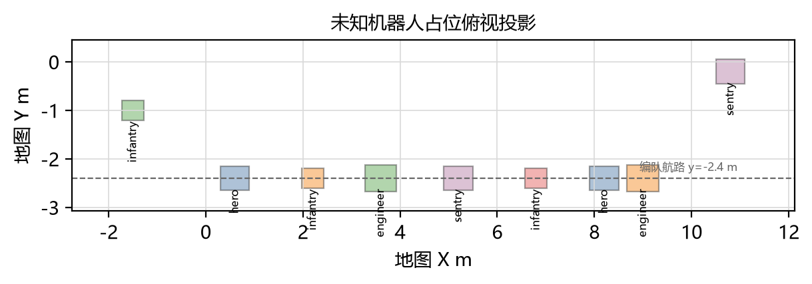
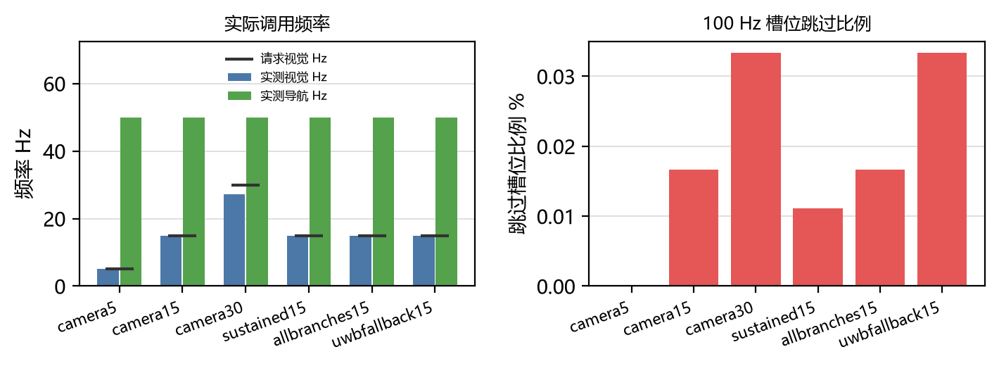
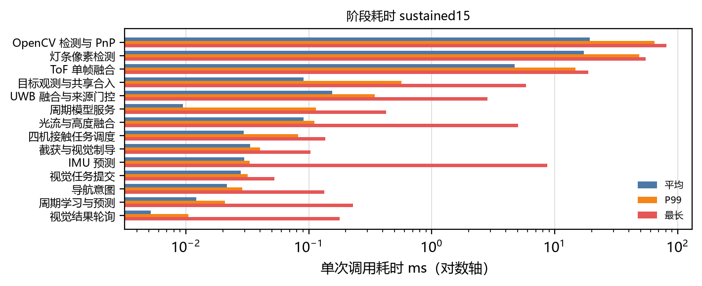
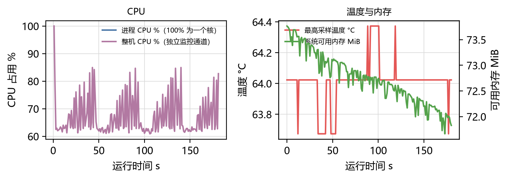
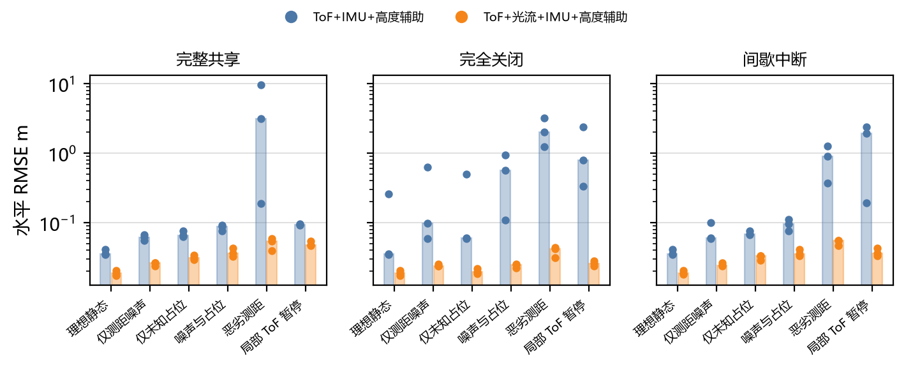
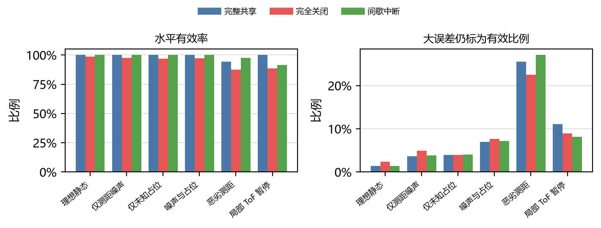
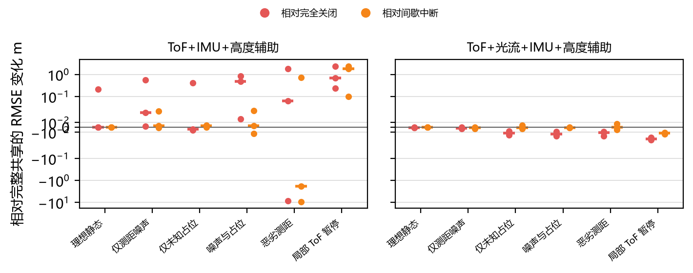

## 无人机定位与板端算力预研报告

对象为 RMUC2027 地图条件下的多机定位与 LicheeRV Nano 板端算力。数据来自仿真敏感性实验、当前实机板端测量与同输入配对通信对照，全部数字由原始 JSON 重新计算。


## 1 摘要与结论

本报告汇总 216 条定位运行记录、6 组完成校验的板端测量与 1 组未完成配置。理想静态场景的水平 RMSE 中位数为 0.028 m，总有效率中位数 100.0%。噪声与占位叠加后 RMSE 中位数 0.059 m，总有效率中位数 100.0%，大误差仍标为有效的比例中位数 5.3%。恶劣测距条件下 RMSE 中位数 0.124 m，最长失连续时间中位数 0.020 s。其中 9 条运行的水平 RMSE 超过 1.0 m，最大 9.553 m。板端参考配置 sustained15 的实测视觉频率 15.00 Hz、实测导航频率 50.00 Hz、进程 CPU 60.1%、最长单轮 20.2 ms、跳过槽位比例 0.0%。定位结论的独立重复为 3 个种子。

相对完整共享，完全关闭的逐种子配对 RMSE 差值中位数为 0.000 m，四分位区间 -0.011 到 0.102 m，13 / 36 组误差增大，其中 6 组绝对变化超过 0.5 m。相对完整共享，间歇中断的逐种子配对 RMSE 差值中位数为 0.000 m，四分位区间 -0.001 到 0.004 m，19 / 36 组误差增大，其中 5 组绝对变化超过 0.5 m。配对差值只覆盖本批场景与种子，不构成协同融合普遍提升或普遍退化的结论。本批 108 条运行中有 9 条水平 RMSE 超过 1.0 m，出现在局部 ToF 暂停、恶劣测距场景、ToF+IMU+高度辅助模式与完全关闭、完整共享、间歇中断通信条件下。最差一条为恶劣测距、ToF+IMU+高度辅助、完整共享、种子 6151，RMSE 9.553 m，总有效率 76.3%。这些样本属于估计器发散，与分位数一起报告，中位数不能代表它们。最长单次调用依次为：OpenCV 检测与 PnP（sustained15，80.860 ms）、灯条像素检测（camera30，66.595 ms）、绿灯检测与平面求交（allbranches15，40.929 ms），调度决策按该排序给出。


## 2 研究范围与方案边界


### 2.1 定位链的组成

本研究的定位结果由三路 8×8 ToF 测距与惯性、高度信息共同给出，不是纯 ToF 解算。ToF 每路 15 Hz 提供视场内的距离观测；IMU 以 100 Hz 提供姿态与加速度预测；高度辅助以 50 Hz 提供垂直方向约束；光流组在同一实验内以 50 Hz 提供机体速度约束。凡涉及精度、有效率与误判比例的结果，均随模式标注，不把光流与高度辅助的贡献并入 ToF。


### 2.2 回放与闭环的差别

实验输入是历史仿真运行记录的轨迹与按模型生成的测量，估计器在固定时间步上回放。回放不等同真实传感器采集与飞控闭环：相机曝光与取帧、ToF 硬件时序、传感器总线、MAVLink 传输、飞控执行与碰撞物理都不在数据链路内。因此本报告给出的是算法层在给定输入条件下的误差、有效率与负载，不是飞行试验的落点或命中结论。


### 2.3 传感器与占位的假设性质

测距误差按随机部分与设备固定偏差分开建模：逐帧白噪声、随距离增长的尺度噪声、逐设备固定偏置与尺度偏差、逐帧公共误差以及丢弃概率。这些取值是研究假设，用于给出误差随条件变化的敏感性，不是厂家保证值，也不替代实机标定。未知机器人占位是带碰撞与可视体的工程包络长方体，只用于遮挡 ToF 视线，尺寸不取自官方 CAD，位置按量程重叠的压力条件放置，不构成合法站位声明。


### 2.4 地图同源与认证边界

传感器观测与估计器先验使用同一静态地图网格，理想场景因此是自洽条件下的对照。理想地图与未知障碍物的对比属于敏感性分析，用于判断遮挡与噪声对误差和有效率的相对影响，不构成实物定位认证。结论的重复单位是独立随机种子，不使用同一条件下的更多帧提高置信度。


### 2.5 实验条件限制

以下限制随全部精度结果同时成立：真值日志只提供位置与 yaw，roll/pitch 固定为 0，属于仅 yaw 姿态重建；传感器与估计器先验共用同一静态地形网格，结构定位精度不代表真实建图误差；高度辅助使用带噪真值高度，不是真实高度传感器；两种融合模式均为 ToF+IMU+高度辅助；机器人以 AABB 射线交点只进入传感器模型，不进入估计器先验；高空飞行时地面机器人遮挡比例可能为 0；共享 schema 中的 tray_pressure 组是托盘平台上的非比赛站位，未纳入六个场景；其遮挡压力不代表正式比赛；UWB 距离与方位由真值相对几何加噪生成，仅用于合成量测；队友位姿来自各估计器快照；初始位置与航向偏移固定，若门控不收敛即为该配置下的实际结果。共享 schema 中未纳入实验的占位分组：tray_pressure。


## 3 研究设计


### 3.1 场景与噪声配置

场景按理想静态、仅测距噪声、仅未知占位、噪声与占位叠加、恶劣测距、局部 ToF 暂停分组，每组噪声参数在全部种子间固定，随机性只来自种子。

**表 1 测距噪声配置**

| 配置 | 白噪声标准差 m | 距离尺度噪声 1/m | 固定偏置上界 m | 尺度偏差上界 | 逐帧公共误差 m | 丢弃概率 |
|:--|--:|--:|--:|--:|--:|--:|
| ideal | 0.000 | 0.000 | 0.000 | 0.000 | 0.000 | 0.00 |
| nominal | 0.010 | 0.005 | 0.015 | 0.005 | 0.005 | 0.03 |
| adverse | 0.025 | 0.015 | 0.030 | 0.010 | 0.015 | 0.10 |


### 3.2 未知障碍物占位

占位体只进入传感器视线与物理遮挡，不进入估计器先验；表中坐标与尺寸为工程包络，落地高度取自地形高度网格。ToF 视场为 8×8 分辨率，水平与垂直视场 45.0°，安装俯角 20.0°，量程 0.02 到 4.0 m，巡航高度 2.3 m。另有 2 个托盘平台占位体用于制造贴身遮挡压力，属非比赛站位工况。地面占位按地形高度网格落地；兵种包络为工程近似尺寸，不是官方 CAD 外形。

**表 2 未知机器人占位**

| 编号 | 角色 | 中心 m | 尺寸 m | 速度 m/s |
|:--|:--|--:|--:|--:|
| route_hero_0 | hero | 0.60, -2.40, 0.54 | 0.60 × 0.50 × 0.60 | 0.00, 0.00, 0.00 |
| route_infantry_1 | infantry | 2.20, -2.40, 0.46 | 0.45 × 0.40 × 0.45 | 0.00, 0.00, 0.00 |
| route_engineer_2 | engineer | 3.60, -2.40, 0.70 | 0.65 × 0.55 × 0.80 | 0.00, 0.00, 0.00 |
| route_sentry_3 | sentry | 5.20, -2.40, 0.24 | 0.60 × 0.50 × 0.60 | 0.00, 0.00, 0.00 |
| route_infantry_4 | infantry | 6.80, -2.40, 0.16 | 0.45 × 0.40 × 0.45 | 0.00, 0.00, 0.00 |
| route_hero_5 | hero | 8.20, -2.40, 0.24 | 0.60 × 0.50 × 0.60 | 0.00, 0.00, 0.00 |
| route_engineer_6 | engineer | 9.00, -2.40, 0.34 | 0.65 × 0.55 × 0.80 | 0.00, 0.00, 0.00 |
| tray_infantry_7 | infantry | -1.50, -1.00, 0.50 | 0.45 × 0.40 × 0.45 | 0.00, 0.00, 0.00 |
| contact_sentry_8 | sentry | 10.80, -0.20, 0.50 | 0.60 × 0.50 × 0.60 | 0.00, 0.00, 0.00 |



*图 1 未知机器人占位俯视投影*


### 3.3 传感器与融合模式

两种融合模式共用同一批测量，区别只在光流支路是否启用。高度辅助使用带噪真值高度，属于仿真条件；两种模式都不是纯 ToF 解算。

**表 3 传感器与频率**

| 环节 | 频率 | 误差模型 |
|:--|--:|:--|
| 三路 8×8 ToF | 15 Hz × 3 路 | 逐像素白噪声、距离尺度噪声、固定偏置与尺度偏差、逐帧公共误差、丢弃 |
| IMU 预测 | 100 Hz | 加速度偏置 0.008 m/s²、白噪声 0.020 m/s²；偏航偏置 0.010 rad、白噪声 0.002 rad |
| 高度辅助 | 50 Hz | 白噪声 0.010 m，使用带噪真值高度 |
| 光流 | 50 Hz | 尺度 1.005、白噪声 0.015 m/s |
| UWB | 20 Hz | 距离 σ 0.150 m、方位 σ 0.080 rad |

**表 4 初始化与辅助条件**

| 项目 | 取值 |
|:--|:--|
| 初始水平偏移 m | 0.080, -0.060 |
| 初始偏航偏移 rad | 0.020 |
| 初始协方差对角 | 0.020 |
| 逐帧真值重置 | 否 |
| 通信延迟 ms | 0 |


### 3.4 通信对照的公平性

通信条件分完整共享、完全关闭与间歇中断三种，同一场景与种子使用同一批测量输入。共享时队友状态来自各机估计器，真值只用于生成传感器观测与离线评分；关闭时估计器不调用队友融合。间歇条件按固定丢包比例与定时中断施加，不改变测量本身。输入指纹用于确认同一场景与种子在各通信条件下使用一致输入。


### 3.5 统计口径与指标定义

重复单位是独立随机种子，同一条件下的连续帧不构成独立重复。误差为世界坐标系水平 RMSE，取全部评分样本；有效率分结构定位有效与总有效两类；大误差仍标为有效指误差超过 0.1 m 且仍被标为有效的样本占全部样本的比例；失连续时间为最长不有效区间；队友更新接受率为被接受的队友约束占全部队友更新的比例。板端负载同时给出平均 CPU、P99 与最长卡顿以及导航实际频率。


## 4 板端算力与调度

测量在 nano-20261023-133926 目录下的运行中进行，本批包含 6 组完成校验的配置：camera5、camera15、camera30、sustained15、allbranches15、uwbfallback15。阶段耗时与资源曲线取参考配置 sustained15。进程 CPU 为进程 CPU 时间除以实际墙钟时间，100% 对应占满一个核心；整机 CPU、1 分钟负载、可用内存与温度由独立监控通道每秒采样，与该进程的进程级读数分开列出。频率为实测调用次数除以运行时长，不用理论帧率替代；单轮 P99 与最长耗时统计计算调用，不含等待下一周期的睡眠。计时范围不含相机取帧、ToF 硬件时序、MAVLink 传输、执行器与 UWB 射频。设备没有可用的 cpufreq 节点，CPU 频率不可用。本测量范围不含加速器，报告中不推断加速器使用情况。

**表 5 定频回放结果**

| 配置 | 时长 s | 实测视觉 Hz | 实测导航 Hz | 进程 CPU % | 整机 CPU % | 跳过槽位 % | 截止期错过 | 单轮 P99 ms | 最长单轮 ms | 最高温度 °C |
|:--|--:|--:|--:|--:|--:|--:|--:|--:|--:|--:|
| camera5 | 60.0 | 5.00 | 50.00 | 33.9 | 38.9 | 0.0 | 381 | 11.95 | 18.68 | 62.3 |
| camera15 | 60.0 | 15.00 | 50.00 | 59.2 | 65.3 | 0.0 | 830 | 15.03 | 23.41 | 63.0 |
| camera30 | 60.0 | 27.17 | 50.00 | 90.4 | 96.8 | 0.0 | 362 | 11.70 | 23.82 | 64.4 |
| sustained15 | 180.0 | 15.00 | 50.00 | 60.1 | 67.1 | 0.0 | 2581 | 14.98 | 20.20 | 64.4 |
| allbranches15 | 60.0 | 15.00 | 50.00 | 68.6 | 76.1 | 0.0 | 820 | 15.01 | 23.76 | 64.0 |
| uwbfallback15 | 60.0 | 15.00 | 50.00 | 59.9 | 66.0 | 0.0 | 554 | 14.87 | 21.57 | 64.0 |



*图 2 板端实际调用频率与跳过槽位比例*

rmuc2027_15 在 9.5 s 后结束，退出状态 -1，内核记录显示 Out of memory: Killed process 1727 (algorithm_load_) total-vm:114440kB, anon-rss:84760kB, file-rss:4kB, shmem-rss:0kB, UID:0 pgtables:232kB oom_score_adj:0。该次运行没有产生任何阶段样本，缺失阶段共 14 个。该配置不计入定频回放表，也不作为算力结论依据；失败原因是当前板端在整幅地形输入下的可用内存上限，需要在降低地形规模或提高可用内存后重新测量。

**表 6 未完成配置**

| 配置 | 墙钟 s | 退出状态 | 判定 |
|:--|--:|--:|:--|
| rmuc2027_15 | 9.5 | -1 | 退出状态 -1，内核内存不足终止 |

**表 7 阶段耗时**

| 阶段 | 调用数 | 平均 ms | P95 ms | P99 ms | 最长 ms | 接受 | 拒绝 |
|:--|--:|--:|--:|--:|--:|--:|--:|
| OpenCV 检测与 PnP | 2700 | 19.303 | 39.432 | 64.993 | 80.860 | 2700 | 0 |
| 灯条像素检测 | 2700 | 17.301 | 39.412 | 48.649 | 54.883 | 2700 | 0 |
| ToF 单帧融合 | 8101 | 4.717 | 10.848 | 14.720 | 18.813 | 8101 | 0 |
| 目标观测与共享合入 | 9000 | 0.091 | 0.431 | 0.569 | 5.819 | 7538 | 1462 |
| UWB 融合与来源门控 | 3600 | 0.155 | 0.328 | 0.343 | 2.848 | 2700 | 8100 |
| 周期模型服务 | 9000 | 0.010 | 0.017 | 0.114 | 0.424 | 0 | 0 |
| 光流与高度融合 | 9000 | 0.091 | 0.098 | 0.111 | 5.018 | 9000 | 0 |
| 四机接触任务调度 | 1800 | 0.030 | 0.037 | 0.082 | 0.136 | 0 | 0 |
| 截获与视觉制导 | 9000 | 0.033 | 0.037 | 0.040 | 0.103 | 7538 | 1462 |
| IMU 预测 | 17998 | 0.030 | 0.032 | 0.033 | 8.719 | 0 | 0 |
| 视觉任务提交 | 2700 | 0.028 | 0.031 | 0.032 | 0.052 | 2700 | 0 |
| 导航意图 | 9000 | 0.022 | 0.027 | 0.029 | 0.133 | 0 | 0 |
| 周期学习与预测 | 9000 | 0.012 | 0.016 | 0.021 | 0.230 | 5762 | 3238 |
| 视觉结果轮询 | 17998 | 0.005 | 0.009 | 0.010 | 0.179 | 0 | 0 |

参考配置中没有调用的阶段在表中省略：绿灯检测与平面求交（在 allbranches15 中有调用）。



*图 3 板端阶段耗时*



*图 4 板端 CPU、温度与可用内存*


## 5 ToF 定位误差与有效率

误差与有效率按场景、融合模式与通信条件分组，每个种子独立运行。本批数据含 3 个独立种子（2027, 4099, 6151），结论的重复单位是种子。



*图 5 各场景水平 RMSE（对数纵轴）*

**表 8 误差与有效率汇总**

| 场景 | 模式 | 通信 | 种子数 | RMSE 中位数 m | 种子范围 m | P95 中位数 m | 最长失连续 s | 总有效率 % | 大误差仍有效 % |
|:--|:--|:--|--:|--:|--:|--:|--:|--:|--:|
| 理想静态 | ToF+IMU+高度辅助 | 完整共享 | 3 | 0.036 | 0.035 ~ 0.041 | 0.068 | 0.040 | 100.0 | 2.7 |
| 理想静态 | ToF+IMU+高度辅助 | 完全关闭 | 3 | 0.036 | 0.035 ~ 0.259 | 0.068 | 0.230 | 97.2 | 4.7 |
| 理想静态 | ToF+IMU+高度辅助 | 间歇中断 | 3 | 0.036 | 0.035 ~ 0.042 | 0.068 | 0.040 | 100.0 | 2.7 |
| 理想静态 | ToF+光流+IMU+高度辅助 | 完整共享 | 3 | 0.019 | 0.017 ~ 0.021 | 0.039 | 0.000 | 100.0 | 0.0 |
| 理想静态 | ToF+光流+IMU+高度辅助 | 完全关闭 | 3 | 0.019 | 0.017 ~ 0.021 | 0.039 | 0.000 | 100.0 | 0.0 |
| 理想静态 | ToF+光流+IMU+高度辅助 | 间歇中断 | 3 | 0.019 | 0.018 ~ 0.021 | 0.039 | 0.000 | 100.0 | 0.0 |
| 仅测距噪声 | ToF+IMU+高度辅助 | 完整共享 | 3 | 0.061 | 0.056 ~ 0.067 | 0.123 | 0.040 | 99.9 | 7.2 |
| 仅测距噪声 | ToF+IMU+高度辅助 | 完全关闭 | 3 | 0.097 | 0.058 ~ 0.628 | 0.230 | 0.830 | 95.4 | 9.8 |
| 仅测距噪声 | ToF+IMU+高度辅助 | 间歇中断 | 3 | 0.061 | 0.059 ~ 0.100 | 0.117 | 0.040 | 99.9 | 7.5 |
| 仅测距噪声 | ToF+光流+IMU+高度辅助 | 完整共享 | 3 | 0.027 | 0.024 ~ 0.027 | 0.045 | 0.000 | 100.0 | 0.1 |
| 仅测距噪声 | ToF+光流+IMU+高度辅助 | 完全关闭 | 3 | 0.024 | 0.024 ~ 0.025 | 0.045 | 0.000 | 100.0 | 0.0 |
| 仅测距噪声 | ToF+光流+IMU+高度辅助 | 间歇中断 | 3 | 0.024 | 0.024 ~ 0.026 | 0.045 | 0.000 | 100.0 | 0.1 |
| 仅未知占位 | ToF+IMU+高度辅助 | 完整共享 | 3 | 0.065 | 0.062 ~ 0.075 | 0.125 | 0.040 | 99.9 | 6.3 |
| 仅未知占位 | ToF+IMU+高度辅助 | 完全关闭 | 3 | 0.060 | 0.059 ~ 0.498 | 0.085 | 1.300 | 94.0 | 7.9 |
| 仅未知占位 | ToF+IMU+高度辅助 | 间歇中断 | 3 | 0.068 | 0.066 ~ 0.076 | 0.142 | 0.040 | 99.9 | 6.5 |
| 仅未知占位 | ToF+光流+IMU+高度辅助 | 完整共享 | 3 | 0.031 | 0.029 ~ 0.034 | 0.042 | 0.000 | 100.0 | 1.6 |
| 仅未知占位 | ToF+光流+IMU+高度辅助 | 完全关闭 | 3 | 0.020 | 0.018 ~ 0.022 | 0.038 | 0.000 | 100.0 | 0.0 |
| 仅未知占位 | ToF+光流+IMU+高度辅助 | 间歇中断 | 3 | 0.033 | 0.029 ~ 0.033 | 0.041 | 0.000 | 100.0 | 1.7 |
| 噪声与占位 | ToF+IMU+高度辅助 | 完整共享 | 3 | 0.089 | 0.076 ~ 0.091 | 0.204 | 0.040 | 99.9 | 11.7 |
| 噪声与占位 | ToF+IMU+高度辅助 | 完全关闭 | 3 | 0.563 | 0.109 ~ 0.947 | 1.838 | 1.300 | 94.2 | 15.3 |
| 噪声与占位 | ToF+IMU+高度辅助 | 间歇中断 | 3 | 0.095 | 0.077 ~ 0.111 | 0.231 | 0.040 | 99.9 | 12.6 |
| 噪声与占位 | ToF+光流+IMU+高度辅助 | 完整共享 | 3 | 0.036 | 0.033 ~ 0.043 | 0.060 | 0.000 | 100.0 | 2.3 |
| 噪声与占位 | ToF+光流+IMU+高度辅助 | 完全关闭 | 3 | 0.025 | 0.022 ~ 0.025 | 0.044 | 0.000 | 100.0 | 0.1 |
| 噪声与占位 | ToF+光流+IMU+高度辅助 | 间歇中断 | 3 | 0.036 | 0.033 ~ 0.041 | 0.055 | 0.000 | 100.0 | 1.7 |
| 恶劣测距 | ToF+IMU+高度辅助 | 完整共享 | 3 | 3.113 | 0.188 ~ 9.553 | 6.982 | 4.440 | 88.9 | 45.1 |
| 恶劣测距 | ToF+IMU+高度辅助 | 完全关闭 | 3 | 2.005 | 1.233 ~ 3.177 | 4.721 | 7.090 | 74.9 | 43.8 |
| 恶劣测距 | ToF+IMU+高度辅助 | 间歇中断 | 3 | 0.898 | 0.371 ~ 1.276 | 2.643 | 1.300 | 95.1 | 49.4 |
| 恶劣测距 | ToF+光流+IMU+高度辅助 | 完整共享 | 3 | 0.054 | 0.040 ~ 0.059 | 0.112 | 0.000 | 100.0 | 6.0 |
| 恶劣测距 | ToF+光流+IMU+高度辅助 | 完全关闭 | 3 | 0.042 | 0.031 ~ 0.044 | 0.065 | 0.000 | 100.0 | 1.3 |
| 恶劣测距 | ToF+光流+IMU+高度辅助 | 间歇中断 | 3 | 0.055 | 0.046 ~ 0.055 | 0.103 | 0.000 | 100.0 | 4.7 |
| 局部 ToF 暂停 | ToF+IMU+高度辅助 | 完整共享 | 3 | 0.094 | 0.092 ~ 0.097 | 0.218 | 0.040 | 99.9 | 16.2 |
| 局部 ToF 暂停 | ToF+IMU+高度辅助 | 完全关闭 | 3 | 0.786 | 0.331 ~ 2.402 | 1.838 | 7.650 | 77.4 | 17.8 |
| 局部 ToF 暂停 | ToF+IMU+高度辅助 | 间歇中断 | 3 | 1.938 | 0.192 ~ 2.403 | 5.452 | 7.220 | 83.2 | 14.6 |
| 局部 ToF 暂停 | ToF+光流+IMU+高度辅助 | 完整共享 | 3 | 0.048 | 0.047 ~ 0.054 | 0.105 | 0.000 | 100.0 | 5.9 |
| 局部 ToF 暂停 | ToF+光流+IMU+高度辅助 | 完全关闭 | 3 | 0.026 | 0.024 ~ 0.028 | 0.050 | 0.000 | 100.0 | 0.1 |
| 局部 ToF 暂停 | ToF+光流+IMU+高度辅助 | 间歇中断 | 3 | 0.037 | 0.033 ~ 0.043 | 0.057 | 0.000 | 100.0 | 1.7 |

本批 108 条运行中有 9 条水平 RMSE 超过 1.0 m，出现在局部 ToF 暂停、恶劣测距场景、ToF+IMU+高度辅助模式与完全关闭、完整共享、间歇中断通信条件下。最差一条为恶劣测距、ToF+IMU+高度辅助、完整共享、种子 6151，RMSE 9.553 m，总有效率 76.3%。这些样本属于估计器发散，与分位数一起报告，中位数不能代表它们。

**表 9 发散样本**

| 场景 | 模式 | 通信 | 种子 | RMSE m | 最大误差 m | 总有效率 % | 大误差仍有效 % |
|:--|:--|:--|--:|--:|--:|--:|--:|
| 恶劣测距 | ToF+IMU+高度辅助 | 完整共享 | 6151 | 9.553 | 38.413 | 76.3 | 35.2 |
| 恶劣测距 | ToF+IMU+高度辅助 | 完全关闭 | 4099 | 3.177 | 10.129 | 68.1 | 41.8 |
| 恶劣测距 | ToF+IMU+高度辅助 | 完整共享 | 4099 | 3.113 | 18.437 | 90.6 | 52.1 |
| 局部 ToF 暂停 | ToF+IMU+高度辅助 | 间歇中断 | 6151 | 2.403 | 10.497 | 73.5 | 12.2 |
| 局部 ToF 暂停 | ToF+IMU+高度辅助 | 完全关闭 | 6151 | 2.402 | 10.497 | 71.3 | 10.9 |
| 恶劣测距 | ToF+IMU+高度辅助 | 完全关闭 | 2027 | 2.005 | 8.011 | 70.5 | 49.8 |
| 局部 ToF 暂停 | ToF+IMU+高度辅助 | 间歇中断 | 4099 | 1.938 | 6.801 | 83.6 | 20.5 |
| 恶劣测距 | ToF+IMU+高度辅助 | 间歇中断 | 4099 | 1.276 | 5.992 | 90.1 | 55.7 |
| 恶劣测距 | ToF+IMU+高度辅助 | 完全关闭 | 6151 | 1.233 | 4.425 | 86.1 | 39.8 |



*图 6 水平有效率与大误差仍标为有效的比例*

**表 10 传感器遮挡与射线结果**

| 场景 | 射线总数 | 有效返回 | 无返回 | 超量程 | 丢弃 | 被占位遮挡 | 遮挡比例 % |
|:--|--:|--:|--:|--:|--:|--:|--:|
| 理想静态 | 277248 | 78642 | 198096 | 510 | 0 | 0 | 0.00 |
| 仅测距噪声 | 277248 | 75064 | 198096 | 1718 | 2369 | 0 | 0.00 |
| 仅未知占位 | 277248 | 74341 | 195677 | 7230 | 0 | 11300 | 4.08 |
| 噪声与占位 | 277248 | 71311 | 195677 | 7818 | 2442 | 11300 | 4.08 |
| 恶劣测距 | 277248 | 66047 | 195677 | 7348 | 8176 | 11300 | 4.08 |
| 局部 ToF 暂停 | 277248 | 65264 | 195677 | 7781 | 2252 | 11300 | 4.08 |

仅未知占位场景下，被占位体挡住的射线每帧平均 11300 条，占全部射线 4.1%。理想场景每帧射线 277248 条，有效返回 78642 条，无返回 198096 条，超量程 510 条。把每个场景的模式与通信条件合并后，仅未知占位的 RMSE 中位数为 0.047 m，理想静态为 0.028 m；两者之差是占位遮挡在本仿真条件下的敏感度量。局部 ToF 暂停场景的最长失连续时间中位数 0.015 s，用于判断暂停段是否被高度与惯性预测覆盖。初始位置与偏航按固定偏差施加且过程中不重置，因此表中的误差包含出生误差的收敛过程。


## 6 多机通信对照

通信对照在同一场景、同一模式与同一种子下配对比较，受限条件的误差变化定义为该条件 RMSE 减去完整共享 RMSE，正值为误差增大。



*图 7 通信受限相对完整共享的 RMSE 变化（纵轴对称对数）*

输入指纹按窗口、场景、模式与种子分组共 72 组，其中 72 组在三种通信条件下完全一致，用于确认配对对照使用同一批测量输入。

ToF+IMU+高度辅助、完全关闭 的配对差值中位数 0.141 m，四分位区间 0.001 到 0.547 m，13 / 18 组误差增大，其中 6 组绝对变化超过 0.5 m。ToF+IMU+高度辅助、间歇中断 的配对差值中位数 0.003 m，四分位区间 0.000 到 0.034 m，14 / 18 组误差增大，其中 5 组绝对变化超过 0.5 m。ToF+光流+IMU+高度辅助、完全关闭 的配对差值中位数 -0.010 m，四分位区间 -0.017 到 -0.002 m，0 / 18 组误差增大，其中 0 组绝对变化超过 0.5 m。ToF+光流+IMU+高度辅助、间歇中断 的配对差值中位数 -0.001 m，四分位区间 -0.002 到 0.000 m，5 / 18 组误差增大，其中 0 组绝对变化超过 0.5 m。队友更新接受率平均 0.9%，因此共享与关闭的差别只来自少量被接受的队友约束。配对比较只在同场景、同模式、同种子内进行；关闭条件不调用队友融合，共享条件的队友状态来自估计器而非真值。

配对差值同时由运行记录重算，并与输入侧的逐种子配对表逐项比对：360 项一致，最大偏差 0.00e+00。


## 7 瓶颈与决策

参考配置 sustained15 的跳过槽位比例为 0.0%，单轮 P99 15.0 ms、最长 20.2 ms，截止期错过 2581 次。单次调用最长的阶段为：OpenCV 检测与 PnP（80.9 ms）、灯条像素检测（54.9 ms）、ToF 单帧融合（18.8 ms）；调度预算应优先覆盖这些阶段，并保留最新输入策略，不补执行积压槽位。

**表 11 最长单次调用排序**

| 阶段 | 最差配置 | 调用数 | 平均 ms | P99 ms | 最长 ms |
|:--|:--|--:|--:|--:|--:|
| OpenCV 检测与 PnP | sustained15 | 2700 | 19.303 | 64.993 | 80.860 |
| 灯条像素检测 | camera30 | 1630 | 15.054 | 49.378 | 66.595 |
| 绿灯检测与平面求交 | allbranches15 | 900 | 7.876 | 31.150 | 40.929 |
| ToF 单帧融合 | camera15 | 2701 | 4.650 | 14.814 | 22.837 |
| 目标观测与共享合入 | allbranches15 | 3000 | 0.087 | 0.612 | 12.475 |
| IMU 预测 | camera5 | 6000 | 0.027 | 0.033 | 11.763 |
| 光流与高度融合 | camera30 | 3000 | 0.098 | 0.190 | 8.072 |
| UWB 融合与来源门控 | uwbfallback15 | 1200 | 0.162 | 0.348 | 4.271 |

决策顺序为：第一，把单次调用最长的阶段移出控制循环或限制每轮计算预算，控制循环只读取已完成结果；第二，为 ToF、视觉与控制分别设定调度预算，保留时间戳与最新帧策略；第三，在真实相机帧下复测视觉分支，再决定视觉频率配置；第四，定位精度结论按模式与通信条件分别引用，不把理想地图同源自洽结果当作实物定位指标。当前 sustained15 的实测导航频率与请求值的差距是是否需要降载的直接判据。


## 8 后续验证

后续验证按以下顺序安排：第一，用实机采集的 ToF 与图像数据重新标定噪声参数，替换本报告的假设取值；第二，在真实多机链路上重复通信对照，覆盖丢包、延迟与断链恢复；第三，把回放链路接入飞控闭环，验证定位误差对轨迹与接触结果的传递；第四，延长板端持续运行时间，观察温度与内存的长期趋势；第五，在更多独立种子上重复遮挡与恶劣测距场景，确认误差分位数的稳定性。


## 9 复现附录


### 9.1 生成命令

```powershell
$ErrorActionPreference = 'Stop'
$reportPython = '<workspace 依赖运行时>/python.exe'
$poppler = '<workspace 依赖运行时>/native/poppler/Library/bin'
& '.venv/Scripts/python.exe' -X utf8 'scripts/build_research_report.py' figures
if ($LASTEXITCODE -ne 0) { throw '图表生成失败' }
& '.venv/Scripts/python.exe' -X utf8 'scripts/build_research_report.py' markdown
if ($LASTEXITCODE -ne 0) { throw 'Markdown 生成失败' }
& $reportPython -X utf8 'scripts/build_research_report.py' pdf
if ($LASTEXITCODE -ne 0) { throw 'PDF 生成失败' }
& "$poppler\pdftoppm.exe" -png -r 110 'docs/research-20261023/report.pdf' 'tmp/report-pages/page'
if ($LASTEXITCODE -ne 0) { throw 'PDF 页面渲染失败' }
```

图表阶段使用仓库 .venv 的 matplotlib；Markdown 与 PDF 阶段由 workspace 依赖运行时执行，该运行时提供 reportlab；逐页 PNG 检查使用同一运行时中的 Poppler。$reportPython 与 $poppler 按该运行时在本机的实际路径填写。


### 9.2 输入数据清单

**表 12 输入文件与摘要**

| 文件 | 字节 | SHA-256 前 16 位 |
|:--|--:|:--|
| simulation/research/scenarios.json | 6470 | b08e28a61735b55b |
| logs/research-20261023/nano-20261023-133926/summary.json | 1144700 | b00c2cdc8dae68af |
| logs/research-20261023/nano-20261023-133926/camera5.json | 70451 | 3f7edde9eb6ec9c7 |
| logs/research-20261023/nano-20261023-133926/camera15.json | 69877 | fb0131db27c2f620 |
| logs/research-20261023/nano-20261023-133926/camera30.json | 69150 | c571d37cc85af223 |
| logs/research-20261023/nano-20261023-133926/sustained15.json | 229948 | 2b4044dbc8e33502 |
| logs/research-20261023/nano-20261023-133926/allbranches15.json | 69945 | 786b566590f6f1e8 |
| logs/research-20261023/nano-20261023-133926/uwbfallback15.json | 70210 | 0a8c8328ffff49be |
| logs/research-20261023/nano-20261023-133926/manifest.json | 11860 | 1e952c16154203d5 |
| build/research-20261023/localization-transit.json | 693548 | e88319cd4cbe7d33 |
| docs/research-20261023/tof-sources.md | 4707 | a99754cd1c96c1ab |
| docs/research-20261023/nano-findings.md | 9606 | 1e5ced2a1bebaf86 |
| docs/research-20261023/localization-findings.md | 22377 | 23527657a8fb12d1 |


### 9.3 图表口径

**表 13 图表输入与计算式**

| 图 | 输入 | 计算式 |
|:--|:--|:--|
| 图 1 | simulation/research/scenarios.json | 占位体 center_m 与 size_m 投影到地图平面 |
| 图 2 | logs/research-20261023/*/ | samples 除以 elapsed_s，跳过比例取 skipped 与 completed |
| 图 3 | logs/research-20261023/*/ | 参考配置阶段 mean、p99 与 max，对数横轴 |
| 图 4 | logs/research-20261023/*/ | 逐秒资源采样与监控通道整机 CPU |
| 图 5 | localization-*.json | 每种子一个点，横条为组内 RMSE 中位数 |
| 图 6 | localization-*.json | xy_valid 与 false_valid 样本比例均值 |
| 图 7 | localization-*.json | 同种子配对差值：受限减完整共享 |


### 9.4 数值核对

报告中的表格与图表均由输入 JSON 重新计算，未引用输入文件中的汇总值。定位记录 216 条，独立种子 3 个，窗口 landing、transit。传感器侧记录 36 条，用于遮挡与射线统计。配对差值重算与逐种子配对表比对 360 项，最大偏差 0.00e+00。输入指纹分组 72 组，其中 72 组在三种通信条件下一致。板端表格取自测量 JSON 的 stages、tick_work 与 resources 字段；整机 CPU 由独立监控通道的 /proc/stat 计数逐间隔重算。

定位实验同时覆盖了 landing 窗口，主表与主图只使用 transit 窗口；其余窗口按下表单独给出，差值为相对同场景同模式的 transit 窗口中位数。

**表 14 其余窗口对照**

| 场景 | 模式 | 种子数 | RMSE 中位数 m | 总有效率 % | 与主窗口差值 m |
|:--|:--|--:|--:|--:|--:|
| 理想静态 | ToF+IMU+高度辅助 | 3 | 0.153 | 95.0 | 0.117 |
| 理想静态 | ToF+光流+IMU+高度辅助 | 3 | 0.025 | 100.0 | 0.006 |
| 仅测距噪声 | ToF+IMU+高度辅助 | 3 | 0.109 | 91.6 | 0.048 |
| 仅测距噪声 | ToF+光流+IMU+高度辅助 | 3 | 0.033 | 100.0 | 0.009 |
| 仅未知占位 | ToF+IMU+高度辅助 | 3 | 0.157 | 92.6 | 0.090 |
| 仅未知占位 | ToF+光流+IMU+高度辅助 | 3 | 0.031 | 100.0 | 0.002 |
| 噪声与占位 | ToF+IMU+高度辅助 | 3 | 0.131 | 92.3 | 0.037 |
| 噪声与占位 | ToF+光流+IMU+高度辅助 | 3 | 0.028 | 100.0 | -0.005 |
| 恶劣测距 | ToF+IMU+高度辅助 | 3 | 0.153 | 92.5 | -1.123 |
| 恶劣测距 | ToF+光流+IMU+高度辅助 | 3 | 0.041 | 100.0 | -0.005 |
| 局部 ToF 暂停 | ToF+IMU+高度辅助 | 3 | 0.131 | 92.3 | -0.199 |
| 局部 ToF 暂停 | ToF+光流+IMU+高度辅助 | 3 | 0.028 | 100.0 | -0.008 |


### 9.5 来源

场景噪声与占位参数、板端测量与定位消融实验分别来自场地与测距干扰、板端负载、通信消融三项实验，对应说明文档为 docs/research-20261023/tof-sources.md、docs/research-20261023/nano-findings.md 与 docs/research-20261023/localization-findings.md。本报告的数字全部由上述原始 JSON 重新计算，未使用二手汇总值。
