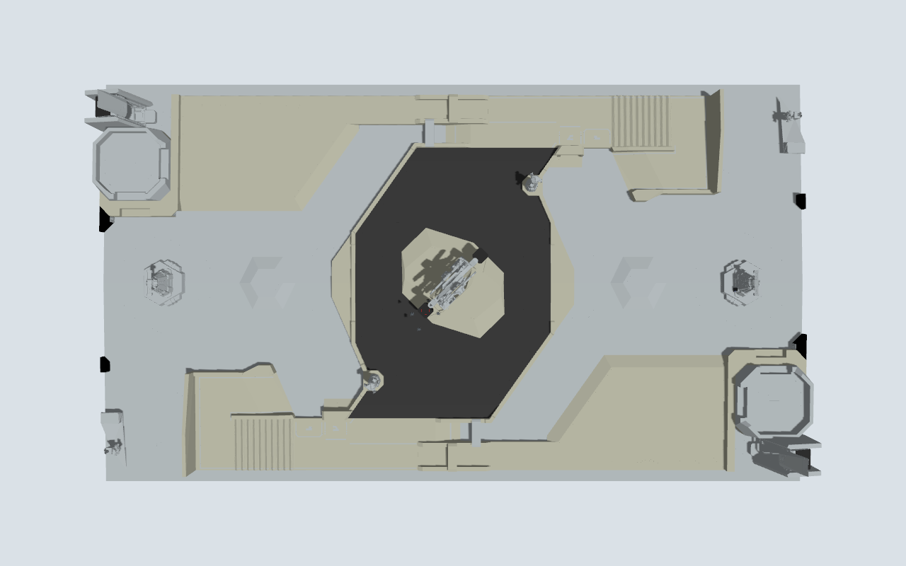
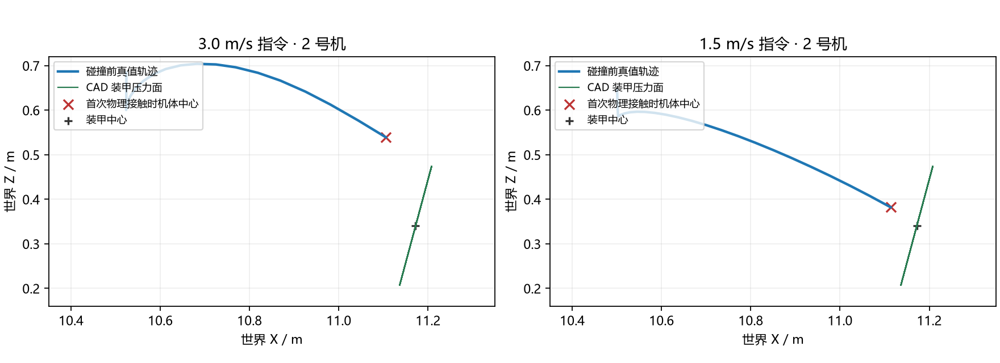
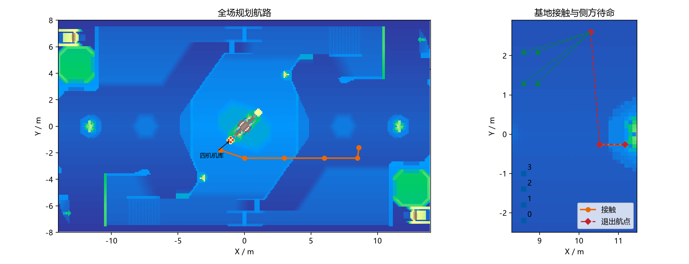
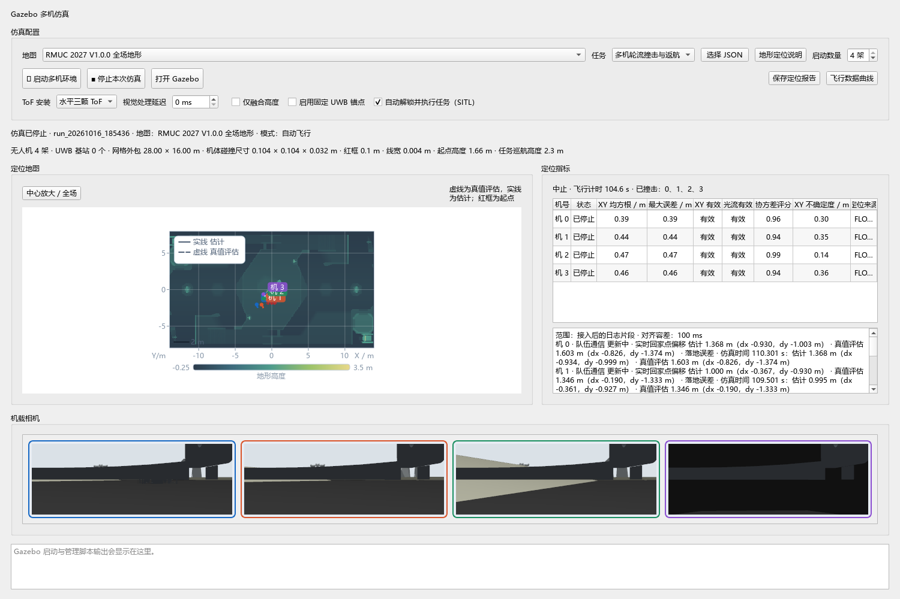

# RMUC 2027 V1.0.0 场地

Gazebo 默认场地为 `simulation/maps/rmuc_2027.json`。图形界面选择“RMUC 2027 V1.0.0 全场地形”，机库容量为四架。

源文件为 `docs/RMUC2027_V1.0.0装配体版本/RMUC2027_V1.0.0.stp`。STEP 装配体包含 81 个部件实例；源文件校验值、坐标变换和网格统计见 [导入报告](rmuc2027-import.json)。

| 参数 | 数值 |
| --- | --- |
| 场地范围 | X：−14～14 m；Y：−8.002～8.002 m |
| 坐标系 | 右手系，Z 向上，红方进攻方向为 +X |
| 主地面坡度 | 1.5°；中央地面脊线为 Z=0 |
| 红方托盘表面高度 | 1.601 m |
| 起始机体中心高度 | 1.660 m |
| 巡航与悬停高度 | 2.300 m |
| 基地装甲目标中心 | (11.172105, −0.261727, 0.340553) m |
| 视觉入口 | 目标前方 0.65 m、上方 0.26 m |
| 末段水平速度指令 | 1.5 m/s |
| 装甲安装方式 | 固定安装，正面接触压力检测 |
| 蓝色灯条材质区域 | 地图配置：高 55 mm、宽 5 mm、中心间距 116 mm |

高度均为世界坐标。仿真融合精确高度辅助，水平状态由机载估计器输出。装甲压力门限为 50 N，用于仿真触压判定。

主地面、两个停机托盘、基地底座及选定装甲压力面保留原始顶点。其他细部按连通曲面简化：原始 4,949,667 面，仿真网格 776,888 面。部件双向采样表面误差最大 51.01 mm，各部件采样均值的最大值为 1.39 mm。渲染、碰撞与定位使用同一米制网格；定位加载时过滤退化面。



## 重建与检查

在项目根目录用 PowerShell 7 执行。STEP 转换依赖列于 `simulation/requirements-cad.txt`。已有装配缓存时直接重建；重新展开 STEP 使用 `--extract`。

```powershell
$ErrorActionPreference = 'Stop'
& '.venv/Scripts/python.exe' -m simulation.import_rmuc2027
if ($LASTEXITCODE -ne 0) { throw '场地重建失败' }
& '.venv/Scripts/python.exe' -m simulation.check_map --output 'build/rmuc2027/clearance.json'
if ($LASTEXITCODE -ne 0) { throw '场地净空检查失败' }
```

视觉检查使用 Gazebo 实际相机图像和生产 PnP 检测器：

```powershell
$ErrorActionPreference = 'Stop'
wsl -d Ubuntu-22.04 --exec /usr/bin/python3 '/mnt/d/Robomaster code/drone/simulation/tests/rmuc2027_armor_smoke.py' --output '/mnt/d/Robomaster code/drone/build/rmuc2027/armor-smoke'
if ($LASTEXITCODE -ne 0) { throw '装甲视觉检查失败' }
wsl -d Ubuntu-22.04 --exec /usr/bin/python3 '/mnt/d/Robomaster code/drone/simulation/tests/rmuc2027_pressure_smoke.py' --world '/mnt/d/Robomaster code/drone/build/rmuc2027/armor-smoke/world.sdf' --output '/mnt/d/Robomaster code/drone/build/rmuc2027/pressure-smoke'
if ($LASTEXITCODE -ne 0) { throw '装甲触压检查失败' }
```

检查结果见 [验证报告](rmuc2027-validation.json)。原始 CAD 与仿真网格的四机起点、编队航段采样净空检查均通过。Gazebo/PX4 四机已完成场地加载与起飞验证；入口相机的装甲识别位置误差为 0.94 mm，重投影误差为 0.36 px。

180 g、半径 52 mm 的球形探针在装甲上方 0.8 m 处自由落下，板端测得峰值 259.34 N，超过 50 N 触压门限。

## 整队任务基线

`run_20261016_171550` 运行 160.051 s。四机完成起飞，协调器依次进入航路、集结、接近和接触阶段；接触期间的水平定位误差抽样为 3.78～5.11 m，入口相机未识别到灯条，四机均接触超时跳过，达标撞击数为 0。返航后因降落阶段超时进入 `ABORTED`；结束时四机原生反馈均为已着地、未解锁，仿真进程已停止。

整队任务尚未通过。静态净空检查覆盖起点、起飞采样与 24 条编队航段，不覆盖完整动态接近及返回轨迹。

## 编队与起降调度

编队偏移和集结位置保持机库起点的相对顺序。等比例推进的编队航段检查中，最小机体中心距为 0.140 m；原分配为 0.086 m。该检查按直线规划计算，实际飞行的相互距离仍取决于定位与控制误差。

地图开启 `vertical_takeoff`：起飞阶段仅发送上升速度，横向速度与偏航角速度为零。地图开启 `sequential_landing`：返航末段各机在航路编队位置等待，按 `landing_order=[3,2,1,0]` 前排先降落。当前机先到起点正上方，再降至托盘上方 80 mm 对准；水平误差不超过 25 mm、水平速度不超过 0.10 m/s，并保持本地结构定位有效 0.5 s 后才下降。当前机着地且解除武装后轮换；降落中止时各机在分散位置下降。该顺序下，规划接近线段与等候机的最小中心距为 0.70 m。

固定装甲启用 `static_armor_localization`。已知 CAD 装甲中心与相机 PnP 的机体系相对位姿共同约束本机位置、航向；观测使用曝光姿态及速度回退，150 ms 以上延迟、重复曝光和创新超限不参与融合。固定目标配置不能用于移动装甲。

| 运行 | 达标触压机号 | 出口及去程航路的机间接触样本 | 结果 |
| --- | --- | --- | --- |
| `run_20261016_174047` | 0、1、2 | 0 | 返航与同时归位降落时发生碰撞，降落超时 |
| `run_20261016_175753` | 0、2 | 0 | 两机末段翻转；返航机未准确落到托盘，逐架降落超时 |

上述两次运行均为 `ABORTED`。触压事件、最终真值坐标及翻转保护记录见验证报告。

## 固定装甲与低位归位验证

3 m/s 指令下，失败机体在 Z≈0.52 m 先接触装甲上方壳体。1.5 m/s 指令使实际轨迹在较低位置接触正面，保留 50 N 压力门限。图中为两次运行 2 号机的真实轨迹与 CAD 压力面。



| 运行 | 达标触压 | 机间接触样本 | 物理验收 |
| --- | --- | --- | --- |
| `run_20261016_182230` | 4/4，288.5～304.0 N | 存在 | 状态为 COMPLETE，降落发生机间碰撞，未通过 |
| `run_20261016_183704` | 4/4，292.1～305.9 N | 4 | 真实落点误差 11～29 mm，降落超时，未通过 |
| `run_20261016_184436` | 4/4 | 0 | 前排优先避免接近路径冲突，对准阶段超时，未通过 |
| `run_20261016_185436` | 4/4，292.1～306.6 N | 0 | 无翻转，低位对准未恢复定位，降落超时，未通过 |

最新运行中，2 号机低位对准时水平偏差约 0.16 m，ToF 匹配持续触发 `terrain_update_trust_region`，超过 0.15 m 总修正上限。全员最终原生着地停机，仿真进程已退出；其余飞机在降落超时后分散着地，未确认全部回到托盘。

独立物理验收同时要求全员达标触压、任务完成、全程无机间碰撞、没有无法恢复保护事件、原生已着地停机，以及末条真值的起点误差不超过 XY 50 mm、Z 35 mm、数据龄不超过 0.2 s。运行命令：

```powershell
$ErrorActionPreference = 'Stop'
& '.venv/Scripts/python.exe' -m simulation.tests.rmuc2027_team_validation 'simulation/runtime/run_20261016_185436' --output 'build/rmuc2027/team-physical-validation.json'
if ($LASTEXITCODE -eq 1) { Write-Output '物理验收未通过，原因见输出 JSON。' }
elseif ($LASTEXITCODE -ne 0) { throw '物理验收执行失败' }
```

21 项原生测试和追加的 13 项地图、界面及物理验收回归通过。完整整队任务的物理验收仍未通过。




